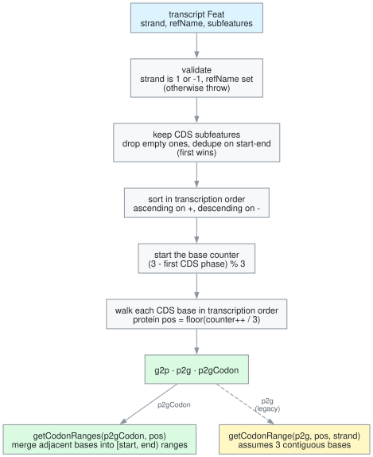

# How the mapping works

`genomeToTranscriptSeqMapping` walks a transcript's CDS bases in transcription
order and numbers them in groups of three.

The graph source is [`img/mapping.dot`](img/mapping.dot); regenerate with
`dot -Tsvg docs/img/mapping.dot -o docs/img/mapping.svg`.

## Steps

1. **Validate.** The parent needs `strand` of `1` or `-1` and a `refName`, or
   the function throws.
2. **Collect CDS.** Only `subfeatures` with `type === 'CDS'` and `start < end`
   count. GFF3 files can repeat CDS rows, so the function keeps the first one
   for each `start-end` pair.
3. **Sort.** Ascending by `start` on the forward strand, descending on the
   reverse strand.
4. **Number the partial codon.** `phase`, read from the first CDS only, counts
   the bases at its start that complete a codon begun outside this transcript.
   By default those bases are protein position `0`, as a JBrowse translation
   writes them (`&`). With `partialCodon: 'dropped'` they map to no position and
   `0` is the first complete codon, as in `gffread -y` or an NCBI protein FASTA.
5. **Walk the bases.** Each remaining base gets protein position
   `floor(counter / 3)`. The function assumes the per-segment phases agree with
   running the counter through every base.

## Reverse strand

The function visits bases from `end - 1` down to `start`, so `p2gCodon` lists
genome positions in transcription order, which is descending. For a
reverse-strand CDS `[0, 6)` the codons become `{ 0: [5, 4, 3], 1: [2, 1, 0] }`,
and `p2g` holds the highest coordinate of each codon.

## Codons that split

A codon that spans an exon boundary has bases that are not contiguous in the
genome.

- `p2gCodon` holds all three positions.
- `getCodonRanges` sorts them and merges adjacent bases, returning one range per
  contiguous piece.
- `getCodonRange`, which the library keeps for backwards compatibility, assumes
  three contiguous bases and returns a range that includes intronic positions
  for a split codon.

## Assumptions

- The mapper translates simple 3-letter codons and does not model selenocysteine
  recoding, ribosomal frameshifts or similar exceptions, so validate against
  your own data.
- All coordinates are 0-based and half-open.
